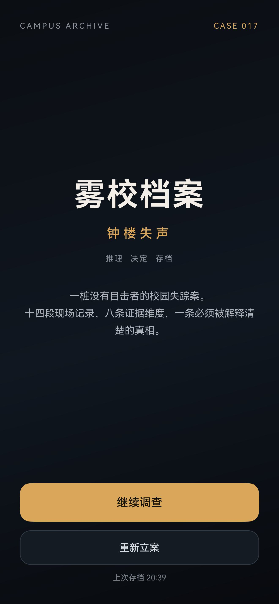
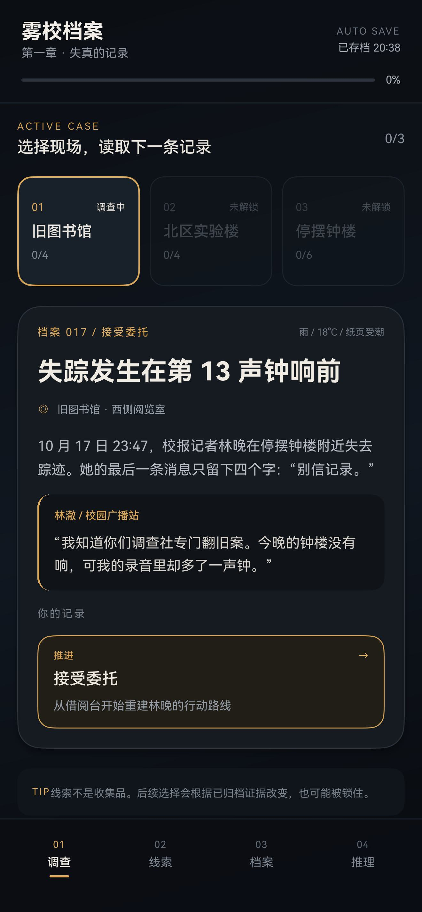
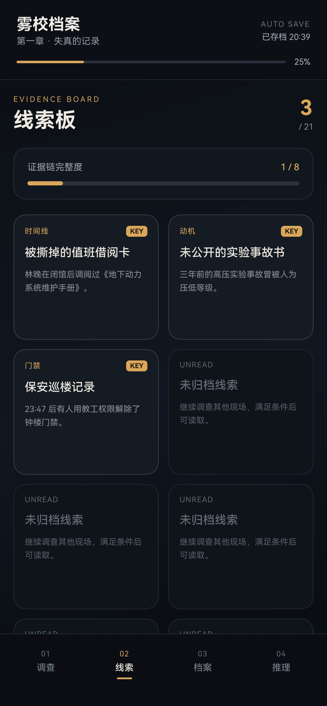
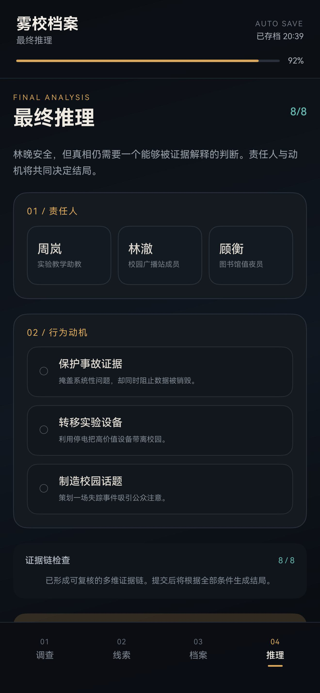
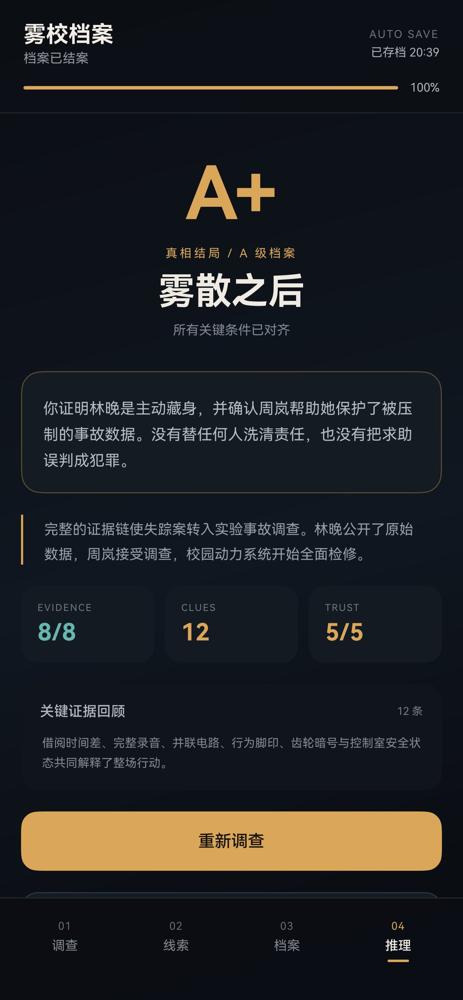
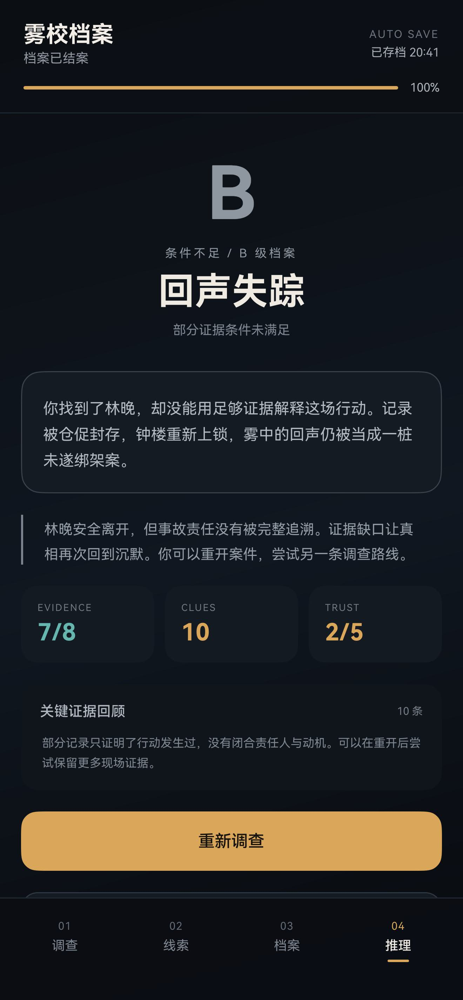
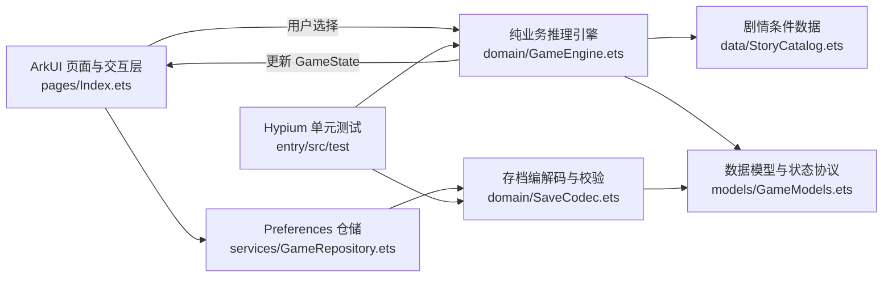

# 雾校档案：钟楼失声

> 主题一作品：校园线索推理与多结局探索 App

《雾校档案：钟楼失声》是一款使用 ArkTS 与 ArkUI 开发的单机推理解谜应用。玩家需要调查旧图书馆、北区实验楼和停摆钟楼，通过场景选择收集线索、改变人物状态并闭合证据链，最终得到两种条件结局之一。

| 首页 | 现场调查 | 线索板 |
| --- | --- | --- |
|  |  |  |

| 最终推理 | A+ 真相结局 | 重启后恢复 |
| --- | --- | --- |
|  |  |  |

条件不足或责任人判断错误时进入 B 级结局，证据链评分和重开入口会同步显示：



完整操作演示：[MysteryGame-demo.mp4](docs/videos/MysteryGame-demo.mp4)

个人报告：[鸿蒙高级应用开发工程师认证-20230416229-夏钰琦-期末大作业报告.docx](docs/report/鸿蒙高级应用开发工程师认证-20230416229-夏钰琦-期末大作业报告.docx)

## 功能亮点

- **完整剧情闭环**：接受委托、现场取证、条件判断、最终推理、进入结局。
- **三处可探索场景**：旧图书馆、北区实验楼、停摆钟楼。
- **14 个事件节点**：每个节点都包含现场描述、人物对话与可执行选择。
- **21 条线索记录**：覆盖时间线、门禁、声音、技术、行为和证词等维度。
- **真实分支依赖**：缺失借阅记录时无法无损开启档案柜；录音是否完整会改变人物合作与新证据选项。
- **双结局判定**：责任人、动机和证据维度共同决定“雾散之后”或“回声失踪”。
- **线索板与阶段进度**：可查看已归档线索、证据链完整度、人物信任、现场压力和选择日志。
- **自动存档恢复**：使用 Preferences 在每次选择后写入本地；关闭进程后可以继续当前事件与进度。
- **异常保护**：损坏存档、旧版本存档、无效选择、证据不足和非法推理阶段均返回可理解结果。
- **自动化测试**：13 条本地单元测试覆盖正常、边界、异常、存档往返和两种结局。

## 核心要求完成情况

| 作业要求 | 实现结果 | 源码位置 |
| --- | --- | --- |
| 至少 3 个探索场景 | 3 个可切换场景 | `entry/src/main/ets/data/StoryCatalog.ets` |
| 至少 12 个事件节点 | 14 个条件事件 | `StoryCatalog.ets` 的 `STORY_EVENTS` |
| 至少 6 条可查阅线索 | 21 条线索，其中多条为互斥或替代证据 | `StoryCatalog.ets` 的 `CLUES` |
| 至少 2 个条件结局 | 真相结局与条件不足结局 | `GameEngine.ets` 的 `finalizeDeduction()` |
| 线索和选择改变后续事件 | 前置线索、替代线索、人物合作状态共同控制选项 | `GameEngine.ets` 的 `isChoiceAvailable()` |
| 线索板、状态和阶段进度 | 独立线索板、证据链、调查状态与阶段时间线 | `pages/Index.ets` |
| 进程重启后恢复 | Preferences 序列化存档并校验版本 | `services/GameRepository.ets` |
| 单元测试覆盖正常、边界、异常 | 13 条测试全部通过 | `entry/src/test/MysteryGameEngine.test.ets` |
| README、截图、运行方法、录屏 | 本文件、`docs/screenshots`、`docs/videos` | 仓库根目录与 `docs/` |

## 系统架构



界面只负责展示与转交用户意图；业务规则集中在 `GameEngine`，因此同一套规则可以被真实 UI 和本地测试共同使用。`GameState` 是一个可序列化快照，选择后由引擎生成新状态，再由 Preferences 持久化。

## 目录结构

```text
.
├─ AppScope/                          应用级配置与图标
├─ entry/src/main/ets/
│  ├─ data/StoryCatalog.ets           场景、事件、选择、线索、结局
│  ├─ domain/GameEngine.ets           分支规则、进度、结局与状态校验
│  ├─ domain/SaveCodec.ets            JSON 编解码与坏档拒绝
│  ├─ models/GameModels.ets           领域模型
│  ├─ pages/Index.ets                 沉浸式 ArkUI 界面
│  ├─ services/GameRepository.ets     Preferences 持久化
│  └─ entryability/EntryAbility.ets   应用入口与沉浸式窗口
├─ entry/src/test/                    13 条 Hypium 本地单元测试
├─ docs/                              需求说明书、测试证据、截图和录屏
├─ tools/                             模拟器 UI 回归与录屏辅助脚本
└─ README.md
```

## 开发环境

| 项目 | 版本 |
| --- | --- |
| DevEco Studio | 26.0.0.865 |
| HarmonyOS SDK | 26.0.0.105 |
| compileSdkVersion / targetSdkVersion | 26.0.0 |
| compatibleSdkVersion | 6.1.1(24) |
| 测试设备 | Mate 90 Pro Max 模拟器，API 26 |
| 语言与框架 | ArkTS、ArkUI、Preferences、Hypium |

## 运行方法

1. 使用 DevEco Studio 26 打开仓库根目录。
2. 等待 Hvigor 与 ohpm 同步完成。
3. 选择 API 24 或更高版本的手机模拟器。
4. 在 DevEco Studio 中配置自动签名，然后点击 Run。

命令行构建示例：

```powershell
$env:DEVECO_SDK_HOME = 'D:\deveco\DevEco Studio\sdk'
& 'D:\deveco\DevEco Studio\tools\hvigor\bin\hvigorw.bat' assembleHap `
  --mode module -p product=default -p module=entry@default `
  -p buildMode=debug --no-daemon
```

构建产物位于 `entry/build/default/outputs/default/`。项目本身不提交 `build`、`.hvigor`、`.idea` 或 `local.properties`。

## 单元测试

```powershell
$env:DEVECO_SDK_HOME = 'D:\deveco\DevEco Studio\sdk'
& 'D:\deveco\DevEco Studio\tools\hvigor\bin\hvigorw.bat' test `
  --mode module -p product=default -p module=entry@default `
  -p buildMode=debug --no-daemon
```

最近一次本地执行结果：**13 通过，0 失败，0 错误**。原始结果与覆盖统计见 [`docs/test-results.md`](docs/test-results.md)。

## 存档策略

- Preferences 实例名：`mystery_case_store`
- 存档键：`active_case_v2`
- 每次有效选择后调用 `put()` 与 `flush()`。
- 打开应用时将 JSON 解析为 `GameState`，校验 `saveVersion`，再执行字段归一化。
- 当 JSON 损坏、版本不符或关键字段非法时，不覆盖原文件，界面回退到安全初始状态。
- 存档包含当前现场、事件游标、已发现线索、分支标志、人物状态、选择日志、最终嫌疑人和动机。

## 测试覆盖

测试同时包含正常路径、边界和异常路径：

- 剧情配置数量达标与初始状态结构
- 档案柜缺少线索时被阻止
- 场景按剧情顺序解锁
- 完整录音和残缺录音产生不同后续可用性
- 两种进入路线都能解锁相同机械分析节点
- 最佳路径进入最终推理
- 正确推理得到 A+ 真相结局
- 错误嫌疑人得到 B 级回声结局
- 证据不足时不能冒充完整证据链
- 存档序列化与反序列化
- 损坏 JSON 和旧版本存档安全拒绝

## 数据恢复验证

自动化流程完成 A+ 结局后强制结束应用进程，再重新启动；首页显示“继续调查”，进入后仍恢复 A+ 结局、12 条线索、8/8 证据维度与 100% 案件进度。对应证据见 `docs/screenshots/08-restored-cover.jpeg` 和 `docs/screenshots/09-restored-ending.jpeg`。

## 官方资料

- [通过用户首选项实现数据持久化（ArkTS）](https://developer.huawei.com/consumer/cn/doc/harmonyos-guides/data-persistence-by-preferences)
- [@State 装饰器：组件内状态](https://developer.huawei.com/consumer/cn/doc/harmonyOS-guides/arkts-state)
- [单元测试框架使用指导](https://developer.huawei.com/consumer/cn/doc/doccenter-testing/unittest-guidelines?docScope=all)
- [如何设置沉浸式窗口](https://developer.huawei.com/consumer/cn/doc/doccenter-dev-faq/faqs-arkui-199)

## 作者与仓库

- GitHub：[@Qqyx86](https://github.com/Qqyx86)
- 仓库：[Qqyx86/MysteryGame](https://github.com/Qqyx86/MysteryGame)
- 完成方式：独立完成
