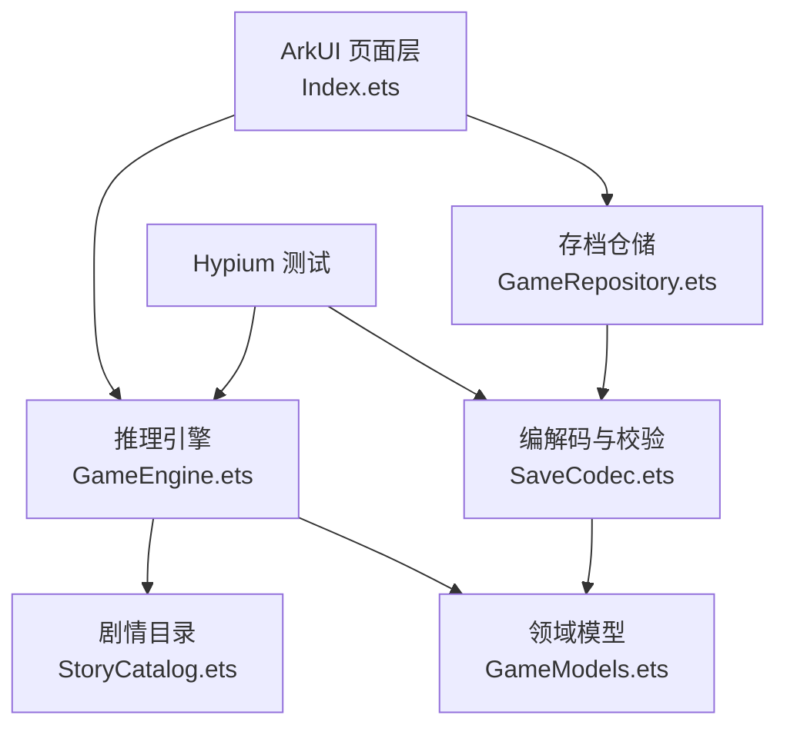

# 雾校档案：钟楼失声 软件需求说明书

## 1. 文档目的

本文档定义《雾校档案：钟楼失声》的功能范围、模块边界、数据模型、接口、异常策略、测试和验收方式，并作为开发、集成和期末验收的共同依据。作品对应课程主题一“迷雾档案”，独立完成。

## 2. 项目信息

| 项目 | 内容 |
| --- | --- |
| 作品名称 | 雾校档案：钟楼失声 |
| 指定主题 | 主题一：校园线索推理与多结局探索 App |
| 完成方式 | 独立完成 |
| GitHub 账号 | Qqyx86 |
| GitHub 仓库 | https://github.com/Qqyx86/MysteryGame |
| 开发工具 | DevEco Studio 26.0.0.865 |
| SDK | HarmonyOS 26.0.0.105；compatibleSdkVersion 6.1.1(24) |
| 目标设备 | 手机；API 24 及以上 |

## 3. 产品目标

应用面向喜欢短篇校园悬疑叙事的用户。玩家以校报调查员身份寻找失踪学生林晚，在三个场景中收集相互印证的线索。作品重点不是线性阅读，而是让证据、路线、人物信任和风险选择改变后续事件，并通过可见状态和阶段进度帮助玩家理解自己的调查处境。

完整体验必须覆盖以下闭环：

1. 接受委托并建立调查档案。
2. 在旧图书馆确认时间线和事故背景。
3. 在北区实验楼核对录音、门禁和动力异常。
4. 在停摆钟楼确认现场路径并找到林晚。
5. 根据责任人、动机与多维证据作出最终判断。
6. 进入两个条件结局之一。
7. 在中途退出并重启后恢复当前进度。

## 4. 用户需求与范围

### 4.1 核心用户需求

- 用户需要理解“当前在哪里、下一条线索是什么、已作出哪些选择”。
- 用户需要看到选择对后续事件的实际影响，而不是只得到不同文字。
- 用户需要能随时查阅已获得线索，并区分关键证据和辅助证据。
- 用户需要在中途退出应用后继续案件，而不是重新开始。
- 用户需要得到明确的结局反馈，并能区分证据充分与条件不足。

### 4.2 范围

本期范围包括：

- 三处场景与 14 个事件节点。
- 21 条线索定义、包含至少 6 条可实际参与结案判定的证据。
- 两种条件结局。
- 线索板、案件档案、阶段进度、人物信任、现场压力和选择日志。
- Preferences 自动存档、启动恢复、重开案件和坏档保护。
- 本地单元测试与真实模拟器运行验证。

本期不包含：

- 在线账号、云同步、多人协作或服务器剧情生成。
- AI 自动生成剧情。
- 真实账号登录、支付、广告或第三方地图能力。
- 平板和折叠屏专用多栏布局；界面在手机竖屏上验收。

## 5. 功能需求

| 编号 | 功能 | 验收条件 |
| --- | --- | --- |
| FR-01 | 建立与继续案件 | 首次进入可建立案卷；存在存档时可继续或重开 |
| FR-02 | 场景探索 | 至少 3 个场景；按图书馆、实验楼、钟楼的顺序解锁 |
| FR-03 | 条件事件 | 14 个事件节点均可通过实际选择推进 |
| FR-04 | 分支依赖 | 线索不足时关键选择被锁定，并显示缺少条件 |
| FR-05 | 替代证据 | 至少两组条件支持“任一证据满足”；不同路线都能继续 |
| FR-06 | 状态变化 | 信任与压力数值随选择变化，限制在 0 至 5 |
| FR-07 | 线索板 | 展示全部线索槽位；已归档线索可查看详情，未归档线索显示为只读 |
| FR-08 | 阶段进度 | 三阶段显示事件完成数、百分比和当前状态 |
| FR-09 | 选择日志 | 记录最近选择、结果摘要与时间 |
| FR-10 | 最终推理 | 必须选择责任人和动机；证据维度达到阈值且判断正确才进入 A 级真相结局 |
| FR-11 | 双结局 | “雾散之后”和“回声失踪”由不同条件触发 |
| FR-12 | 自动存档 | 每次有效选择后写入 Preferences 并刷新 |
| FR-13 | 恢复 | 强制结束进程后重新启动，恢复当前事件、线索、状态、阶段与结局 |
| FR-14 | 重开 | 用户确认后清除当前案卷，保留已解锁的最佳结局标识 |
| FR-15 | 异常处理 | 非法选择、无效场景、损坏存档和存储失败均有反馈，不崩溃 |

## 6. 业务规则

### 6.1 场景顺序

- 旧图书馆：初始解锁。
- 北区实验楼：旧图书馆场景完成后解锁。
- 停摆钟楼：北区实验楼场景完成后解锁。
- 最终推理：停摆钟楼最后一个事件完成后进入 `deduction` 阶段。

### 6.2 分支条件

- 开启密封档案柜可以要求借阅记录，也可以选择高风险撬锁路线。
- 完整听到录音后，周岚的“合作解释”选项可用；只截取末段录音时该选项被锁定。
- 动力图分析要求完整录音或异常负荷记录作为技术依据。
- 钟楼门禁的干净进入要求完整录音与并联线路证据；否则可使用攀爬路线。
- 机械室分析接受门禁残码或攀爬纤维中的任一有效进入证据。
- 维护门开启接受备用门禁卡或齿轮暗号中的任一机械证据。

### 6.3 结局规则

真相结局需要同时满足：

- 责任人选择 `周岚`。
- 动机选择 `保护事故证据`。
- 八组证据维度中至少发现六组。

不满足任一条件时进入“回声失踪”结局。结局提交后案件进入 `ending` 阶段，不再接受现场选择。

## 7. 非功能需求

### 7.1 可用性

- 主要触摸目标高度不低于 43 vp。
- 所有正文在 1320×2848 模拟器屏幕上可读，长内容使用滚动容器。
- 选择被锁定时显示“缺少线索”或条件说明，不仅降低透明度。
- 存档状态固定显示在顶部与档案页。

### 7.2 可靠性

- 业务状态通过纯函数进行不可变更新。
- 存档写入使用 `put()` 后调用 `flush()`。
- 存档读取先校验 `saveVersion`，再归一化场景、事件、线索、阶段和结局字段。
- Preferences 或 JSON 异常时不覆盖原始文件，并回退到可操作状态。

### 7.3 可维护性

- 剧情内容、业务规则、持久化和 UI 分离。
- 测试直接调用领域函数，不依赖 UI 坐标。
- 新增场景时只扩展 `SCENES`、`STORY_EVENTS` 与解锁规则。
- 每个选择条件显式声明“全部线索”和“任一替代线索”。

## 8. 系统架构



页面层接收触摸事件，将选择 ID 交给引擎；引擎读取当前节点和选择条件，返回新的完整状态。页面将新状态写入 `@State` 触发重建，随后调用仓储保存。启动时仓储读取 JSON，编解码器检查版本并归一化状态，页面据此显示首页或上次所在页签。

## 9. 模块划分与接口关系

| 模块 | 主要职责 | 输入/输出 | 负责人 |
| --- | --- | --- | --- |
| UI 模块 | 首页、场景卡、事件卡、线索板、档案、推理页 | 用户点击 → 状态与页面变更 | 马瑶函 |
| 剧情配置模块 | 定义场景、事件、选择、线索和结局 | 事件 ID → 可展示内容 | 马瑶函 |
| 推理引擎 | 校验选择、推进节点、维护状态、判定结局 | GameState + 选择 → ActionResult | 马瑶函 |
| 存档模块 | Preferences 初始化、读写、失败处理 | GameState → JSON / JSON → GameState | 马瑶函 |
| 测试模块 | 验证业务规则、存档和边界 | Mock 状态 → 断言结果 | 马瑶函 |

## 10. 数据设计

| 数据对象 | 关键字段 | 业务含义 | 存储方式 |
| --- | --- | --- | --- |
| `GameState` | `phase`, `activeSceneId`, `sceneCursors`, `discoveredClues`, `flags`, `trust`, `pressure`, `endingId` | 一次案件的完整可恢复快照 | Preferences 中 JSON 字符串 |
| `SceneCursor` | `sceneId`, `nodeId`, `completed` | 每个场景当前事件和完成状态 | 随 GameState 序列化 |
| `StoryEventDef` | `id`, `sceneId`, `narrative`, `dialogue`, `choices` | 一个可交互事件节点 | 只读内置数据 |
| `ChoiceDef` | 条件线索、替代线索、后继节点、新增线索、标志、状态增减 | 一次选择及其业务后果 | 只读内置数据 |
| `ClueDef` | `title`, `summary`, `detail`, `tag`, `keyEvidence` | 可查阅证据记录 | 只读内置数据 |
| `JournalEntry` | `eventId`, `choiceLabel`, `note`, `time` | 玩家选择历史 | 随 GameState 序列化 |

## 11. 状态设计

```text
investigating
  ├─ 选择并推进事件
  ├─ 增加线索/标志/信任/压力
  └─ 三场景完成后 → deduction

deduction
  ├─ 选择责任人 + 动机
  └─ 计算证据维度 → ending

ending
  ├─ 雾散之后（周岚 + 保护事故证据 + 至少 6 组证据）
  └─ 回声失踪（其他条件）
```

## 12. 接口定义

| 接口/方法 | 输入参数 | 返回值 | 异常/边界处理 |
| --- | --- | --- | --- |
| `applyChoice(state, choiceId)` | 当前状态、选择 ID | `ActionResult` | 非法阶段、非法选择、缺少线索时 `accepted=false` |
| `selectScene(state, sceneId)` | 当前状态、场景 ID | `ActionResult` | 未解锁场景拒绝切换 |
| `isChoiceAvailable(state, choice)` | 当前状态、选择定义 | `boolean` | 支持全部线索、任一替代线索和标志条件 |
| `getChoiceBlockedReason(state, choice)` | 当前状态、选择定义 | 可读原因 | 没找到具体线索时返回通用原因 |
| `finalizeDeduction(state, suspect, motive)` | 推理阶段状态、嫌疑人、动机 | `DeductionResult` | 阶段或选项为空时拒绝提交 |
| `normalizeState(candidate)` | 已解析存档对象 | 安全 `GameState` | 过滤非法场景、事件、线索、重复项和非法版本 |
| `encodeSave(state)` | `GameState` | JSON 字符串 | 不修改输入对象 |
| `decodeSave(rawValue)` | 原始字符串 | `GameState \| null` | JSON 损坏或版本不符时返回空 |
| `GameRepository.save(state)` | `GameState` | `Promise<void>` | 写入或刷新失败时记录日志并抛出给 UI 处理 |

## 13. 持久化与恢复设计要求

Preferences 实例名为 `mystery_case_store`，存档键为 `active_case_v2`。每次有效选择、提交推理、重开案件后均应调用 `flush()`。恢复时执行以下检查：

1. 字符串是否为空。
2. JSON 是否可解析。
3. `saveVersion` 是否等于 2。
4. 当前场景、事件、线索和结局 ID 是否合法。
5. 数组是否包含重复或未知条目。
6. `trust`、`pressure` 是否限制在 0 至 5。

上述检查失败不得造成崩溃；解码器返回 `null`，页面建立新案卷并给出提示。

## 14. 边界与异常设计

| 情况 | 处理 |
| --- | --- |
| 用户尚未获得借阅卡就尝试无损开柜 | 选项锁定并提示缺少借阅记录 |
| 用户仅获得攀爬纤维时尝试齿轮分析 | 通过“任一进入路线证据”规则正常解锁 |
| 用户重复点击同一状态推进 | 当前节点已改变，旧选择无法再次执行 |
| 证据维度低于 6 组时选择正确嫌疑人 | 仍进入条件不足结局，不伪造真相 |
| 存档 JSON 被截断 | 捕获解析异常并返回 `null` |
| 存档版本为旧版本 | 拒绝该快照，避免字段错位 |
| Preferences 写入失败 | UI 保留本次内存状态，显示存档失败，避免中断交互 |
| 用户点击未解锁场景 | 显示解锁条件，不切换场景 |
| 用户提交空嫌疑人或空动机 | 拒绝提交并提示先完成推理选择 |

## 15. 测试设计

| 编号 | 类别 | 前置/Mock 输入 | 预期结果 |
| --- | --- | --- | --- |
| T01 | 正常 | 加载内置剧情目录 | 至少 3 场景、12 事件、6 线索、2 结局 |
| T02 | 正常 | 新建 GameState | 位于旧图书馆与 E01 事件 |
| T03 | 正常 | 选择 `inspect_loan` | 添加借阅线索并推进到 E03 |
| T04 | 边界 | 跳过借阅卡后尝试 `open_with_card` | 选项不可用，选择被拒绝 |
| T05 | 正常 | 完成图书馆四节点 | 实验楼解锁、钟楼仍锁定 |
| T06 | 分支 | 完整录音 vs 残缺录音 | 周岚合作选项的可用性不同 |
| T07 | 边界 | 仅拥有门禁残码 | 机械分析仍可执行 |
| T08 | 正常 | 完成最佳路线 | 进入 deduction，证据维度不少于 7 |
| T09 | 正常 | 周岚 + 保护事故证据 | 返回真相结局和 A+ |
| T10 | 异常 | 林澈 + 保护事故证据 | 返回条件不足结局和 B |
| T11 | 边界 | 仅 1 条线索直接进入推理 | 不能冒充完整真相 |
| T12 | 正常 | 完整状态编码后解码 | 阶段、线索和场景保持一致 |
| T13 | 异常 | 截断 JSON、旧版本 JSON | 返回 `null`，不抛异常 |

## 16. 验收标准

- `hvigorw assembleHap` 成功，应用可在 API 26 模拟器安装和启动。
- `hvigorw test` 成功，至少 6 条测试通过；本项目要求 13 条全部通过。
- 正常路径可完整运行至 A+ 真相结局。
- 错误嫌疑人或证据不足路径可进入 B 级结局。
- 应用被强制结束后重新打开，可恢复当前案件。
- README 包含功能、环境、截图、视频和运行方法。
- 报告引用真实 Commit、源码路径、测试日志与运行截图。

## 17. 开发与协作约定

本项目按独立完成执行，所有模块由马瑶函设计与集成。仓库按以下原则维护：

- `main` 为可运行分支。
- 提交按“领域引擎 → 界面与持久化 → 文档和证据”拆分，便于核查开发过程。
- 构建缓存、本机 SDK 路径、IDE 配置和测试缓存不得提交。
- 报告中的 Commit 哈希、行号、测试结果必须与仓库实际内容一致。

## 18. 参考资料与核查计划

| 资料 | 主要结论 | 使用位置 |
| --- | --- | --- |
| [通过用户首选项实现数据持久化（ArkTS）](https://developer.huawei.com/consumer/cn/doc/harmonyos-guides/data-persistence-by-preferences) | Preferences 适合轻量级键值数据；写入后需 `flush()` 持久化 | `GameRepository.ets` |
| [@State 装饰器：组件内状态](https://developer.huawei.com/consumer/cn/doc/harmonyOS-guides/arkts-state) | `@State` 用于组件内部可观察状态，修改后触发界面刷新 | `Index.ets` |
| [单元测试框架使用指导](https://developer.huawei.com/consumer/cn/doc/doccenter-testing/unittest-guidelines?docScope=all) | Hypium 提供 `describe`、`it`、`expect` 与 Mock 等能力 | `MysteryGameEngine.test.ets` |
| [如何设置沉浸式窗口](https://developer.huawei.com/consumer/cn/doc/doccenter-dev-faq/faqs-arkui-199) | 主窗口可使用 `setWindowSystemBarEnable` 设置系统栏显隐 | `EntryAbility.ets` |
| HarmonyOS SDK 26 本机声明文件 `@ohos.data.preferences.d.ts` | `getPreferences`、`put`、`flush` 的异步 API 与异常类型 | 接口实现与版本核对 |

后续升级 API 时，先核对本机 SDK 的类型声明和当年官方版本说明，再使用模拟器执行构建、13 条回归测试和进程重启恢复检查。
